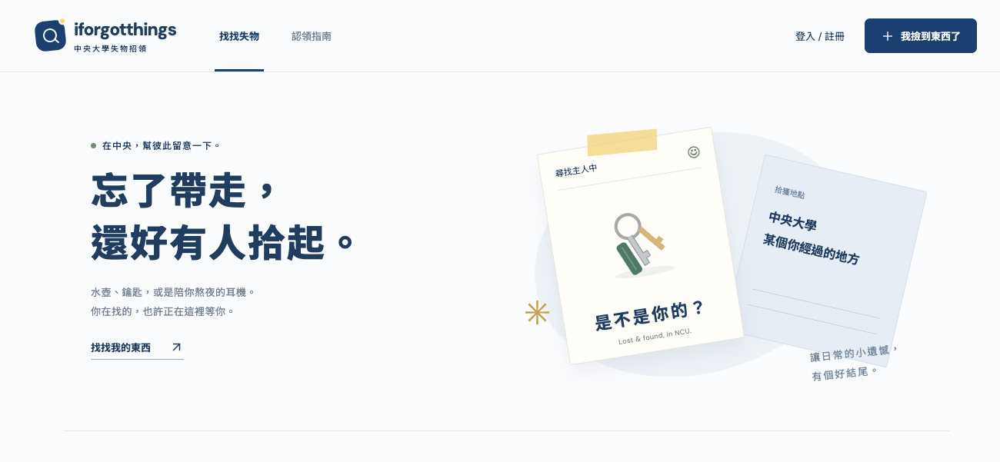
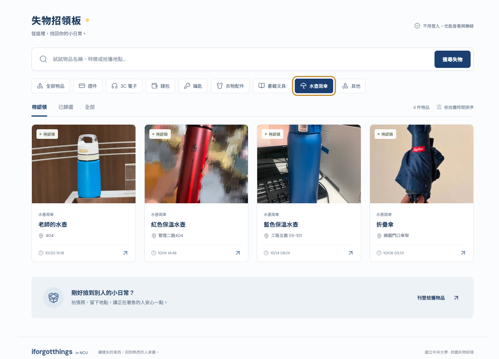

# iforgotthings · in NCU

中央大學校園失物招領系統。此 repository 同時容納前端與後端專案。





## 目錄

- [`frontend/`](frontend/)：React 前端，包含原始碼、靜態資源、套件設定、部署範本與預覽截圖。
- [`backend/`](backend/)：Flask + PostgreSQL 後端，提供 10 支 API（帳號、貼文、照片上傳），已部署於 PVE 容器 111（`http://10.10.10.111:5000`）。

## 啟動前端

在 repository 根目錄執行：

```sh
cd frontend
npm install
npm run dev
```

打包時在 `frontend/` 執行 `npm run build`，產物位於 `frontend/dist/`。

預設使用示範資料。Flask API 連接方式、環境變數及部署設定請參閱 [`frontend/README.md`](frontend/README.md)。

## 啟動後端

需要 Python 3.11 以上與 PostgreSQL（資料庫須為 UTF-8 編碼）。建立資料庫、`.env` 設定、
測試資料與 PVE 容器部署步驟請參閱 [`backend/README.md`](backend/README.md)。

```sh
cd backend
python -m venv .venv
.venv\Scripts\activate          # Linux：. .venv/bin/activate
pip install -r requirements.txt
flask --app app init-db
flask --app app seed-db
python app.py                   # http://127.0.0.1:5000
```

前端開發時，在 `frontend/.env.local` 設定 `VITE_DATA_MODE=api`，Vite 會把 `/api` 與 `/uploads` 代理到後端。
